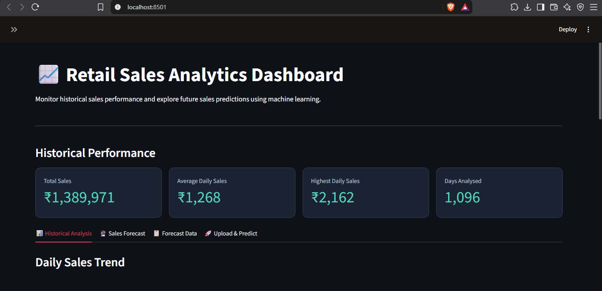
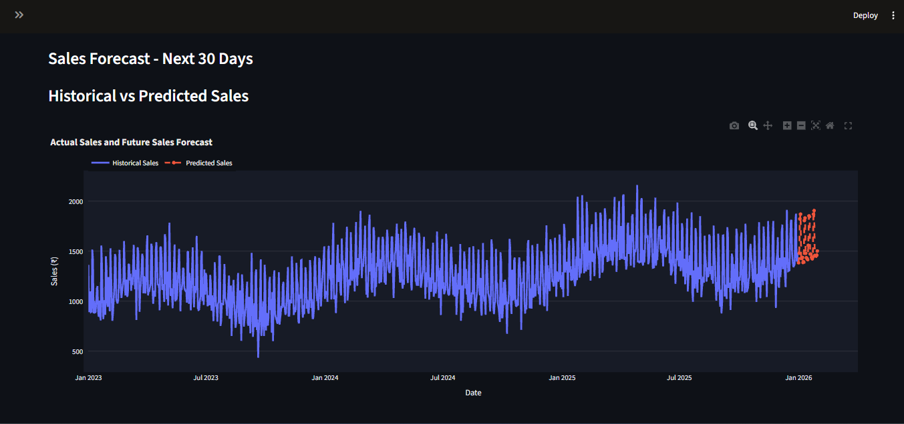
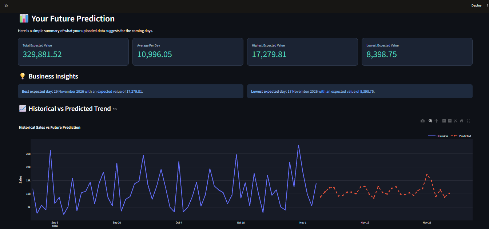

# 📊 Retail Sales Analytics & Forecasting Dashboard

An interactive **Retail Sales Analytics and Forecasting** project built using Python, Pandas, Plotly, Scikit-learn and Streamlit. Explore historical sales performance, review forecasts, and upload your own dataset to generate predictions and visualize historical versus predicted values.

## 🖼️ Dashboard Preview

> Add your screenshots to the `images` folder using the filenames below. GitHub will display them in this section.

### Historical Analysis


### Sales Forecast — Actual vs Predicted


### Custom Dataset — Upload & Predict


## ✨ Dashboard Features

### 📊 Historical Analysis
- Interactive historical sales trend
- Average sales by weekday
- Average monthly sales analysis
- Date-range filtering

### 🔮 Sales Forecast
- Combined historical and predicted sales line chart
- Actual sales and future forecast values displayed together
- Forecast horizon selection
- Forecast KPIs and trend insights

### 📋 Forecast Data
- Forecast results table
- Download forecast data

### 🚀 Upload & Predict (Custom Dataset)
- Upload CSV or Excel data inside the **Upload & Predict** tab
- Select the date column and numeric target column
- Configure forecasting settings, where available
- Train a forecasting model on your dataset
- Visualize historical values and future predictions together
- Review and download forecast results

## 📁 Project Structure

```text
Retail-Sales-Forecasting-Python/
├── app.py
├── requirements.txt
├── README.md
├── notebooks/
│   └── Retail_Sales_Forecasting.ipynb
├── images/
│   ├── historical_analysis.png
│   ├── sales_forecast.png
│   └── custom_prediction.png
├── data/
└── outputs/
    ├── cleaned_retail_sales.csv
    └── retail_sales_forecast_30_days.csv
```

> The dashboard loads its default historical and forecast datasets from the `outputs/` folder. Include the required CSVs in your repository and keep their filenames consistent with those used in `app.py`.

## 🛠️ Technologies Used
- Python
- Pandas and NumPy
- Plotly
- Scikit-learn
- Streamlit
- Jupyter Notebook

## ▶️ Run Locally

1. Clone/download the repository and open the project folder in VS Code.
2. Open a terminal in the project root (the folder containing `app.py`).
3. (Optional) Create and activate a virtual environment:
   ```bash
   python -m venv .venv
   .venv\Scripts\activate
   ```
   On macOS/Linux: `source .venv/bin/activate`
4. Install dependencies:
   ```bash
   pip install -r requirements.txt
   ```
5. Ensure the required files are present in `outputs/`.
6. Start the dashboard:
   ```bash
   streamlit run app.py
   ```
7. Open the local URL shown in your terminal (usually `http://localhost:8501`).

## ☁️ Deploy on Streamlit Community Cloud

Push `app.py`, `requirements.txt`, the required `outputs/` files and any other project files to GitHub. In Streamlit Community Cloud, create a new app, select your repository and branch, set `app.py` as the entry point, and deploy.

## 📌 Notes
- The custom prediction feature expects a date-like column and a numeric column to forecast.
- Forecasts are estimates and may not reflect actual future sales.

## 👩‍💻 Portfolio Project

This project demonstrates data preparation, exploratory analysis, visualization, basic forecasting, and interactive dashboard development—skills relevant to entry-level Data Analyst roles.
