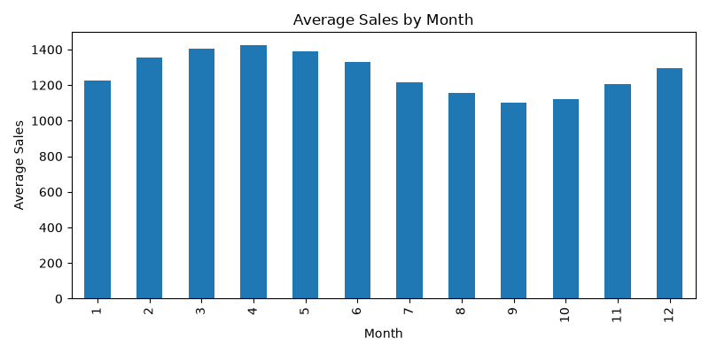
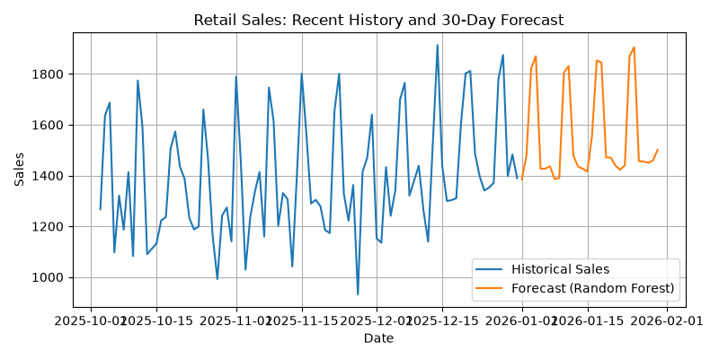

# 📊 Retail Sales Forecasting & Analytics

A Python-based retail sales analytics and forecasting project. The Jupyter Notebook covers data cleaning, exploratory analysis, feature engineering and forecasting. The Streamlit application presents historical sales trends, weekday and monthly bar charts, a sales-contribution pie chart, forecasting visuals, and a CSV download.

## Project files

- `notebooks/Retail_Sales_Forecasting.ipynb` — original analysis notebook (kept unchanged).
- `app.py` — updated Streamlit app; **the separate Business Overview section has been removed**.
- `outputs/cleaned_retail_sales.csv` — cleaned historical data required by the app.
- `outputs/retail_sales_forecast_30_days.csv` — forecast data required by the app.
- `requirements.txt` — required Python packages.

> The Streamlit app currently loads the two CSV files from the `outputs/` folder. Ensure these files are included in your repository with the exact names above.

## Dashboard features

- Historical date-range filtering
- Daily historical sales line chart
- Average sales by weekday (bar chart)
- Average sales by month (bar chart)
- Sales contribution by weekday (pie chart)
- Forecast visualization and forecast KPIs
- Forecast details and CSV download
- Upload your own CSV or Excel file and generate a custom forecast

## Run locally

1. Install Python (3.10+ recommended).
2. Clone or download this repository and open its folder in VS Code.
3. Open the terminal in the project root (the folder containing `app.py`).
4. (Recommended) Create and activate a virtual environment:

   **Windows**
   ```bash
   python -m venv .venv
   .venv\Scripts\activate
   ```

   **macOS/Linux**
   ```bash
   python -m venv .venv
   source .venv/bin/activate
   ```

5. Install packages:
   ```bash
   pip install -r requirements.txt
   ```
6. Confirm the `outputs` folder contains `cleaned_retail_sales.csv` and `retail_sales_forecast_30_days.csv`.
7. Start the dashboard:
   ```bash
   streamlit run app.py
   ```
8. Streamlit opens in your browser. If it does not, copy the local URL shown in the terminal (usually `http://localhost:8501`).

## Publish / deploy using GitHub and Streamlit Community Cloud

1. Push the complete project to a GitHub repository. Include `app.py`, `requirements.txt`, the notebook, and the required `outputs` CSV files.
2. Go to [Streamlit Community Cloud](https://share.streamlit.io/) and sign in using GitHub.
3. Select **Create app** / **Deploy an app**.
4. Choose your repository, branch (typically `main`), and main file path `app.py`.
5. Deploy. Keep the `outputs/` folder and CSVs in the repository because the app reads them at startup.
6. After future changes are pushed to GitHub, Streamlit Cloud can redeploy the app.

## Libraries

Python, Pandas, NumPy, Matplotlib (Notebook), Plotly, Scikit-learn, Streamlit.

## Disclaimer

<<<<<<< HEAD
Forecasts are estimates based on historical data and should not be treated as guaranteed results.
=======
The project explores:

- 📈 Historical sales trends.
- 📅 Average sales by weekday.
- 🗓️ Monthly sales patterns.
- 📊 Annual sales trends.
- 🔍 Sales distribution and patterns.

## ⚙️ Feature Engineering

The following features were created to improve forecasting:

- Day
- Month
- Year
- Day of Week
- Weekend Indicator
- 1-Day Lag
- 7-Day Lag
- 14-Day Lag
- 28-Day Lag
- 7-Day Rolling Mean
- 28-Day Rolling Mean

## 🤖 Machine Learning Models

### 📌 Linear Regression

Used as a baseline model to estimate future retail sales.

### 🌳 Random Forest Regressor

Used to model more complex relationships between historical sales patterns and future sales.

## 📏 Model Evaluation

The models were evaluated using:

- 📉 MAE (Mean Absolute Error)
- 📊 RMSE (Root Mean Squared Error)
- 📈 R² (R-squared)

The models were compared using a chronological test period to evaluate forecasting performance.

## 🔮 Sales Forecasting

The project generates a forecast for the next 30 days using trained Machine Learning models.

The forecast demonstrates how historical sales data can be used to support demand planning and business analysis.

## 📈 Project Visualizations

### 📊 Historical Sales Trend


### 📅 Average Sales by Weekday


### 🗓️ Monthly Sales



### 🔮 30-Day Sales Forecast



### 🗓️Yearly Sales Dashboard


### 📊 Retail Sales Dashboard


## 💼 Business Applications

The analysis and forecast could help retail businesses:

- 📦 Understand historical sales trends.
- 📅 Identify high and low sales periods.
- 📊 Support inventory planning.
- 🔮 Prepare for potential changes in demand.
- 🤖 Compare forecasting model performance.
- 💡 Support data-driven decision-making.

## ⚠️ Project Limitations

- The dataset is synthetic and not actual company sales data.
- Forecast accuracy depends on the patterns present in the dataset.
- Real-world sales may be influenced by promotions, prices, holidays, stock availability, competition and external events.
- Forecasting results should not be treated as guaranteed future sales.

## 📁 Project Structure

```text
Retail-Sales-Forecasting-Python/
│
├── 📓 notebooks/
│   └── Retail_Sales_Forecasting.ipynb
│
├── 📂 data/
│   ├── synthetic_retail_sales.csv
│   └── raw_retail_sales_with_issues.csv
│
├── 📊 outputs/
│   ├── cleaned_retail_sales.csv
│   ├── model_comparison.csv
│   ├── test_predictions.csv
│   ├── retail_sales_forecast_30_days.csv
│   ├── business_summary.txt
│   ├── sales_trend.png
│   ├── weekday_sales.png
│   ├── monthly_sales.png
│   └── sales_dashboard.png
│
├── 🐍 run_project.py
├── 📦 requirements.txt
└── 📄 README.md
```

## ▶️ How to Run the Project

1. Clone the repository.
2. Install the required Python libraries.
3. Open the Jupyter Notebook.
4. Run the notebook cells sequentially.

## 📌 Key Skills Demonstrated

- Python Programming
- Data Cleaning
- Exploratory Data Analysis (EDA)
- Pandas & NumPy
- Data Visualization
- Feature Engineering
- Machine Learning
- Time-Series Forecasting
- Model Evaluation
- Business Analysis

## 👨‍💻 Author

**Data Analytics Portfolio Project**

⭐ If you find this project interesting, feel free to explore the notebook and visualizations.
>>>>>>> ce38a4414db0140d32c0f2ec7a8610d7beba1527
