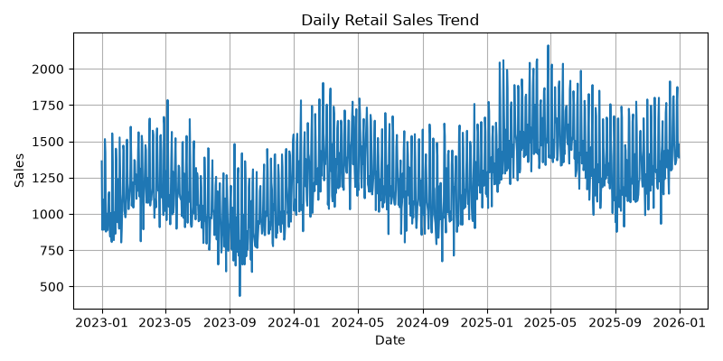
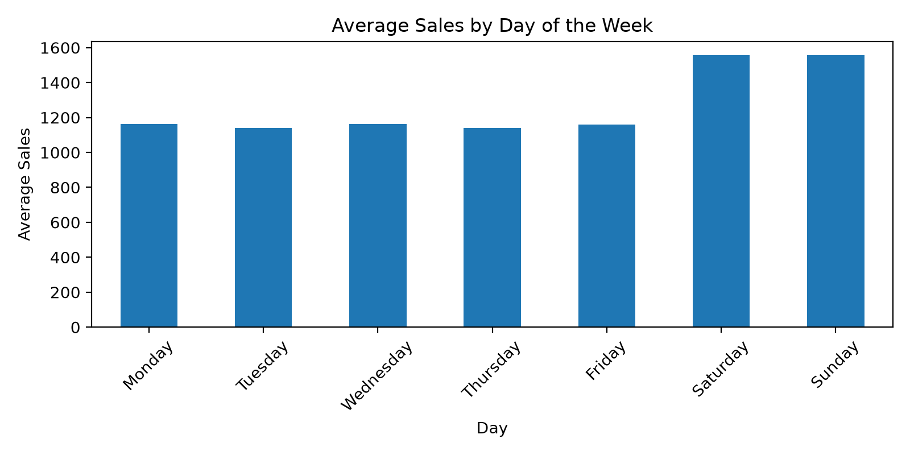
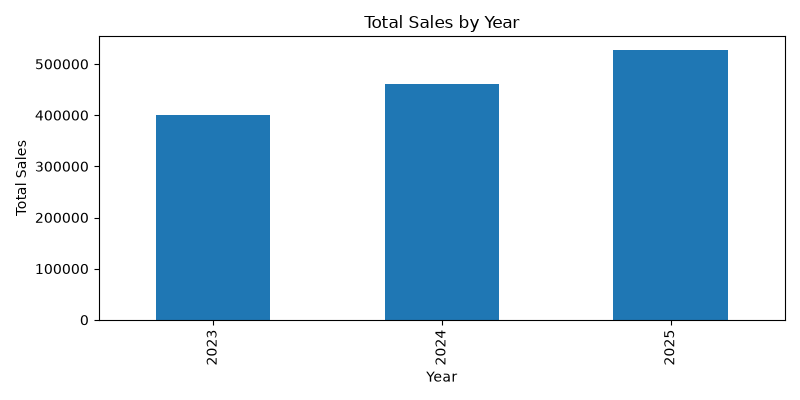
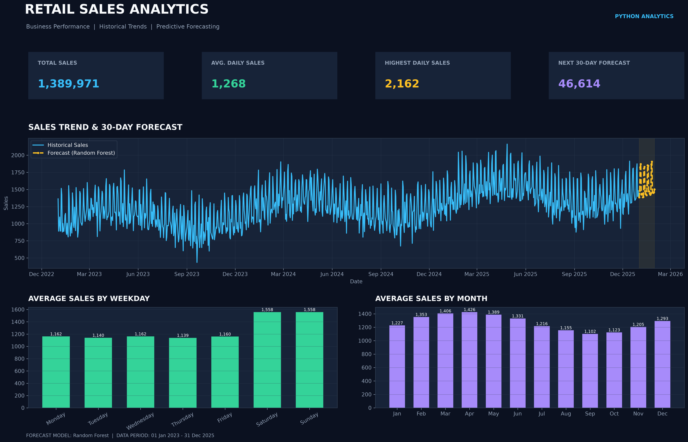

# 📊 Retail Sales Forecasting Using Python

## 🚀 Project Overview

This project analyzes historical retail sales data, identifies sales trends and patterns, and forecasts sales for the next 30 days using Machine Learning.

The project uses Python for data cleaning, Exploratory Data Analysis (EDA), feature engineering, model development, model evaluation, and business-oriented visualization.

## 🎯 Business Problem

Retail businesses need to understand historical sales patterns to plan inventory, manage stock, and anticipate future demand.

This project explores historical sales data and develops forecasting models to estimate future sales and identify patterns that could support business planning.

## 🎯 Project Objectives

- 🧹 Clean and prepare retail sales data.
- 🔍 Handle missing values and duplicate records.
- 📊 Perform Exploratory Data Analysis (EDA).
- 📈 Identify sales trends and weekly/monthly patterns.
- ⚙️ Create time-series features such as lag values and rolling averages.
- 🤖 Build and compare Machine Learning models.
- 🔮 Forecast sales for the next 30 days.
- 📉 Visualize findings using Python.

## 🛠️ Tools and Technologies

- 🐍 Python
- 📓 Jupyter Notebook
- 🧮 Pandas
- 🔢 NumPy
- 📊 Matplotlib
- 🎨 Seaborn
- 🤖 Scikit-learn

## 🔄 Project Workflow

1. 📥 Dataset generation and data loading
2. 🔎 Data inspection and cleaning
3. 🧹 Missing value handling
4. 🗑️ Duplicate removal
5. 📊 Exploratory Data Analysis
6. ⚙️ Feature engineering
7. 📅 Train-test splitting based on time
8. 🤖 Model development
9. 📏 Model evaluation
10. 🔮 30-day forecasting
11. 📈 Visualization and business interpretation

## 🧹 Data Cleaning

The dataset was prepared by:

- Identifying missing sales values.
- Interpolating missing sales values.
- Removing duplicate records.
- Sorting the dataset chronologically.
- Preparing data for analysis and forecasting.

## 📊 Exploratory Data Analysis (EDA)

The project explores:

- 📈 Historical sales trends.
- 📅 Average sales by weekday.
- 🗓️ Monthly sales patterns.
- 📊 Annual sales trends.
- 🔍 Sales distribution and patterns.

## ⚙️ Feature Engineering

The following features were created to improve forecasting:

- Day
- Month
- Year
- Day of Week
- Weekend Indicator
- 1-Day Lag
- 7-Day Lag
- 14-Day Lag
- 28-Day Lag
- 7-Day Rolling Mean
- 28-Day Rolling Mean

## 🤖 Machine Learning Models

### 📌 Linear Regression

Used as a baseline model to estimate future retail sales.

### 🌳 Random Forest Regressor

Used to model more complex relationships between historical sales patterns and future sales.

## 📏 Model Evaluation

The models were evaluated using:

- 📉 MAE (Mean Absolute Error)
- 📊 RMSE (Root Mean Squared Error)
- 📈 R² (R-squared)

The models were compared using a chronological test period to evaluate forecasting performance.

## 🔮 Sales Forecasting

The project generates a forecast for the next 30 days using trained Machine Learning models.

The forecast demonstrates how historical sales data can be used to support demand planning and business analysis.

## 📈 Project Visualizations

### 📊 Historical Sales Trend



### 📅 Average Sales by Weekday



### 🗓️ Monthly Sales


### 🔮 30-Day Sales Forecast


### 🗓️Yearly Sales Dashboard



### 📊 Retail Sales Dashboard



## 💼 Business Applications

The analysis and forecast could help retail businesses:

- 📦 Understand historical sales trends.
- 📅 Identify high and low sales periods.
- 📊 Support inventory planning.
- 🔮 Prepare for potential changes in demand.
- 🤖 Compare forecasting model performance.
- 💡 Support data-driven decision-making.

## ⚠️ Project Limitations

- The dataset is synthetic and not actual company sales data.
- Forecast accuracy depends on the patterns present in the dataset.
- Real-world sales may be influenced by promotions, prices, holidays, stock availability, competition and external events.
- Forecasting results should not be treated as guaranteed future sales.

## 📁 Project Structure

```text
Retail-Sales-Forecasting-Python/
│
├── 📓 notebooks/
│   └── Retail_Sales_Forecasting.ipynb
│
├── 📂 data/
│   ├── synthetic_retail_sales.csv
│   └── raw_retail_sales_with_issues.csv
│
├── 📊 outputs/
│   ├── cleaned_retail_sales.csv
│   ├── model_comparison.csv
│   ├── test_predictions.csv
│   ├── retail_sales_forecast_30_days.csv
│   ├── business_summary.txt
│   ├── sales_trend.png
│   ├── weekday_sales.png
│   ├── monthly_sales.png
│   └── sales_dashboard.png
│
├── 🐍 run_project.py
├── 📦 requirements.txt
└── 📄 README.md
```

## ▶️ How to Run the Project

1. Clone the repository.
2. Install the required Python libraries.
3. Open the Jupyter Notebook.
4. Run the notebook cells sequentially.

## 📌 Key Skills Demonstrated

- Python Programming
- Data Cleaning
- Exploratory Data Analysis (EDA)
- Pandas & NumPy
- Data Visualization
- Feature Engineering
- Machine Learning
- Time-Series Forecasting
- Model Evaluation
- Business Analysis

## 👨‍💻 Author

**Data Analytics Portfolio Project**

⭐ If you find this project interesting, feel free to explore the notebook and visualizations.
